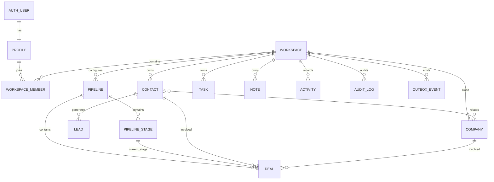

# Modelo de Dados — v0.01

## Diagrama ER conceitual

## Tabelas

### profiles
Perfil da pessoa autenticada.

### workspaces
Tenant operacional.

### workspace_members
Associação usuário-workspace e papel.

### contacts
Pessoa/contato canônico.

### companies
Organização/empresa relacionada.

### contact_companies
N:N entre contato e empresa.

### leads
Processos de entrada/qualificação vinculados a contato.

### pipelines
Funil configurável.

### pipeline_stages
Etapas ordenadas.

### deals
Oportunidades/negócios.

### tasks
Ações com responsável e vencimento.

### notes
Notas relacionadas a entidades.

### activities
Timeline comercial/eventos de domínio.

### audit_logs
Trilha técnica e administrativa.

### outbox_events
Eventos a processar de forma assíncrona.

## Índices essenciais

Toda tabela de negócio deve ter índice iniciando por `workspace_id` nas consultas frequentes.

Exemplos:
- contacts(workspace_id, lower(email));
- contacts(workspace_id, created_at desc);
- leads(workspace_id, status, created_at desc);
- deals(workspace_id, pipeline_id, stage_id);
- tasks(workspace_id, assignee_id, due_at);
- activities(workspace_id, entity_type, entity_id, created_at desc).
