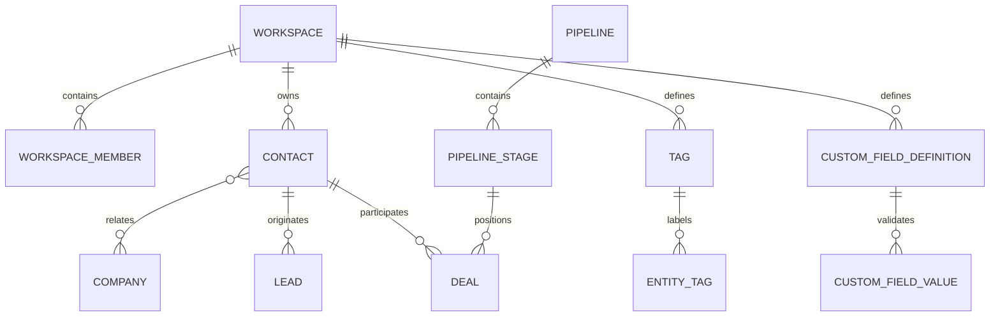

# Modelo de Dados

## Entidades e finalidade

| Tabela | Chave/tenant | Finalidade |
|---|---|---|
| `profiles` | `id` → auth.users | perfil do usuário |
| `workspaces` | `id` | tenant operacional |
| `workspace_members` | `(workspace_id,user_id)` | membership, papel e status |
| `contacts` | `id`, `workspace_id` | pessoa/contato |
| `companies` | `id`, `workspace_id` | organização |
| `contact_companies` | contato + empresa + workspace | relação N:N e principal |
| `leads` | `id`, `workspace_id` | oportunidade em qualificação |
| `pipelines` | `id`, `workspace_id` | funil de vendas |
| `pipeline_stages` | `id`, pipeline + workspace | estágios ordenados |
| `deals` | `id`, `workspace_id` | oportunidade comercial |
| `tasks` | `id`, `workspace_id` | trabalho acionável |
| `notes` | `id`, `workspace_id` | anotação multi-entidade |
| `activities` | `id`, `workspace_id` | timeline comercial |
| `audit_logs` | `id`, `workspace_id` | trilha técnica de mutações |
| `outbox_events` | `id`, `workspace_id` | eventos privados assíncronos |
| `tags` | `id`, `workspace_id` | catálogo de tags |
| `entity_tags` | `id`, tag + entidade + workspace | associação multi-entidade |
| `custom_field_definitions` | `id`, `workspace_id` | metadados e tipo do campo |
| `custom_field_values` | `id`, definição + entidade + workspace | valor JSON validado |

## Relações principais

## Enums

- `workspace_role`: owner, admin, manager, sales, marketing, finance, support, viewer;
- `record_status`: active, inactive, archived;
- `lead_status`: new, working, qualified, unqualified, converted, archived;
- `deal_state`: open, won, lost;
- `task_priority`: low, normal, high, urgent;
- `task_status`: open, in_progress, completed, cancelled;
- `custom_field_type`: text, textarea, integer, decimal, currency, boolean, date, datetime, select, multiselect, email, phone, url.

## FTS e Contact 360

`search_document tsvector` é gerado em `contacts`, `companies`, `leads` e `deals`, com índices GIN. A view `contact_360_summary` agrega empresa principal e contadores de leads, deals, pipeline aberto, tarefas, tags, campos e última atividade, mantendo RLS por `security_invoker=true`.

## Integridade

FKs compostas incluem `workspace_id` nas relações críticas. Triggers validam referências polimórficas, owner/assignee ativo, tags, custom fields, timestamps e estado do deal. A validação não deve ser removida em favor de validação exclusiva no frontend.

