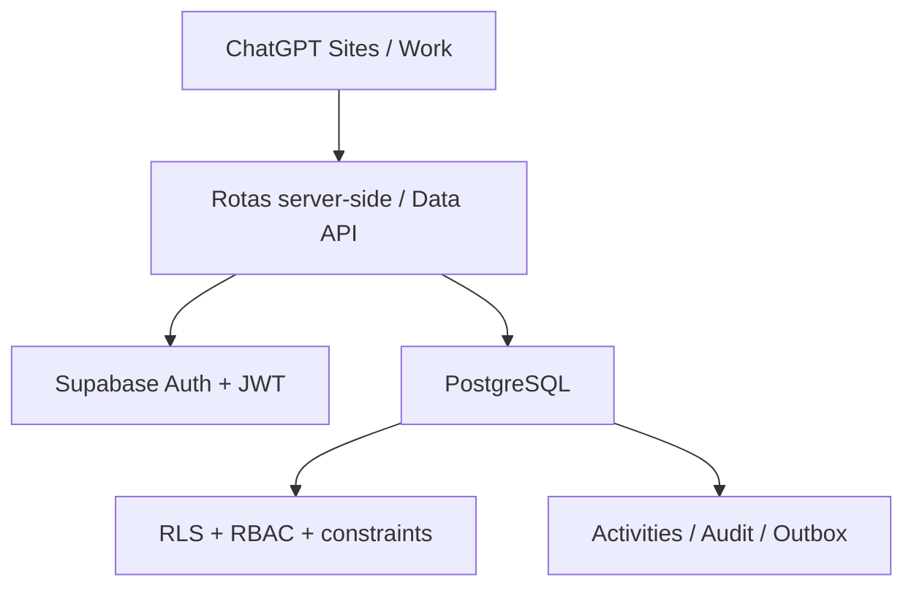

# Arquitetura Técnica

## Visão lógica

## Componentes

### Frontend

Next.js/Sites, design system existente, sidebar/topbar, auth, seletor de workspace, dashboard, contatos, Busca Global e Contact 360. O frontend transporta intenção e apresenta estados; não decide autorização.

### Backend de aplicação

Rotas server-side controlam cookies/sessão e chamadas ao Supabase. O JWT do usuário deve alcançar o banco para que RLS seja aplicada. Publishable key é aceitável no cliente; chaves privileged não são.

### Banco

PostgreSQL concentra entidades, regras invariantes, integridade cross-tenant, FTS, triggers, view e RPCs. O schema `private` abriga helpers privileged; o schema `public` expõe apenas contratos deliberados.

### Assíncrono

Transações gravam estado e, quando aplicável, evento em `outbox_events`. Worker futuro lê/processa com credencial backend, idempotência, tentativas, `available_at`, `processed_at` e `last_error`.

## Princípios

- API-first e frontend substituível;
- segurança no banco, não na confiança da UI;
- least privilege;
- migrations imutáveis após promoção;
- observabilidade separada por finalidade;
- contratos estáveis e versionados;
- rollback antes de produção.

## Fontes de verdade

Work documenta; Git executa; Supabase armazena. Uma versão do Site não substitui o commit Git, e o estado aplicado do banco não substitui os arquivos de migration.

